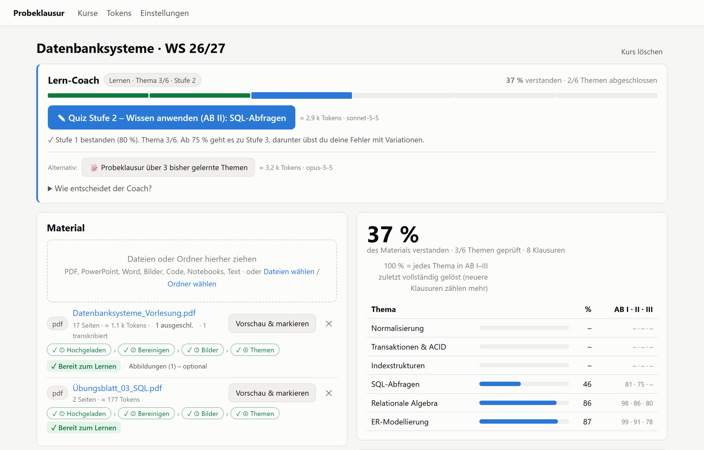
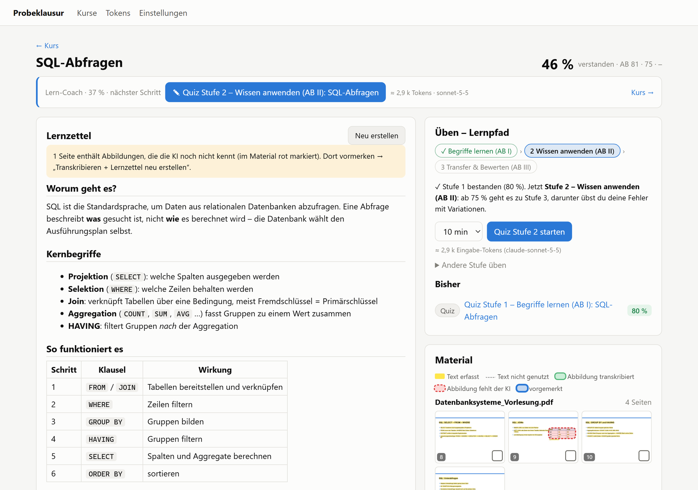
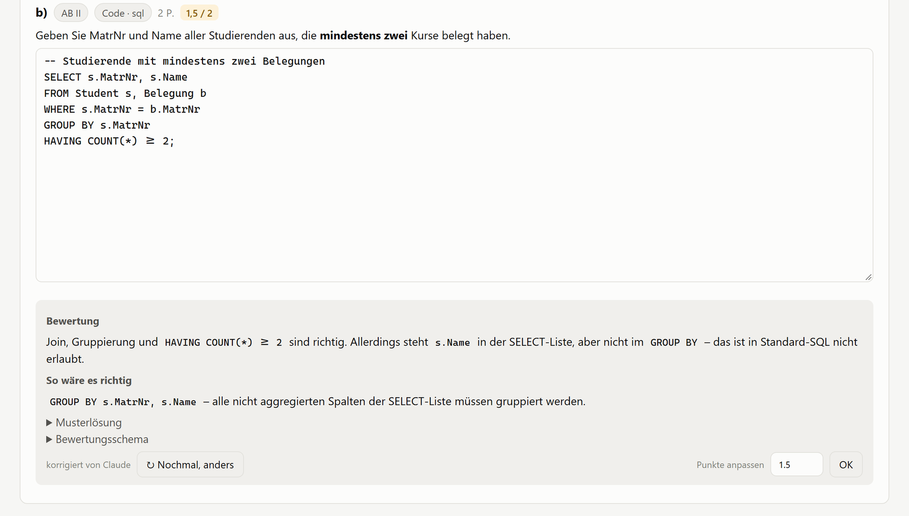

<div align="center">

# 📝 KlausurLernen

**Vom Vorlesungsmaterial zur bestandenen Klausur – lokal, Schritt für Schritt, mit Claude.**

Material reinziehen → Lernzettel → Quizze → realistische Probeklausuren → KI-Korrektur → Verständnis bis 100 %


**⚡ KOMPLETT GEVIBECODED!**

</div>

<picture>
  <source media="(prefers-color-scheme: dark)" srcset="docs/screenshots/coach-dark.png">
  
</picture>

<sub>Alle Screenshots zeigen einen Demo-Kurs mit erfundenen Daten.</sub>

---

**Inhalt:** [Was es kann](#-was-es-kann) · [Schnellstart](#-schnellstart) · [So lernst du damit](#-so-lernst-du-damit) · [Lern-Coach](#-lern-coach) · [Material vorbereiten](#-material-vorbereiten) · [Themen & Lernpfad](#-themen--lernpfad) · [Klausuren & Korrektur](#-klausuren--korrektur) · [Verständnis-Score](#-verständnis-score) · [Token-Sparmaßnahmen](#-token-sparmaßnahmen) · [Projektstruktur](#-projektstruktur)

---

## ✨ Was es kann

| Funktion | Beschreibung |
|---|---|
| ▶ **Lern-Coach** | Ein Knopf für den jeweils nächsten Schritt – nur ihn zu drücken, führt durchs gesamte Material bis 100 % |
| 📂 **Jedes Format** | PDF, PowerPoint, Word, Bilder, Code, Notebooks, Markdown/Text/LaTeX – Dateien oder ganze Ordner |
| 📖 **Lernzettel** | Pro Thema aus *deinem* Material: Kernbegriffe, Schritt für Schritt, Beispiel, typische Fehler, Selbsttest |
| 🎯 **Lernpfad** | Kurz-Quizze in drei Stufen (AB I → II → III), Fehler werden so lange variiert, bis sie sitzen |
| 📝 **Probeklausuren** | Realistisch, Schwerpunkt AB II/III, im Stil deines Dozenten (Übungen/Altklausuren als Vorlage) |
| ✅ **Korrektur** | Objektive Formate lokal, offene Antworten von Claude – mit Begründung und „So wäre es richtig“ |
| 📈 **Verständnis-Score** | Pro Thema und AB-Stufe, neuere Versuche zählen mehr |
| 💸 **Token-sparsam** | Lokale Vorverarbeitung, Caching, gezielte Materialauswahl, Verbrauchsübersicht |
| 🔒 **Lokal** | Alle Kurse, Uploads und Ergebnisse bleiben in `data/` auf deinem Rechner (nicht im Git) |

---

## 🚀 Schnellstart

**Voraussetzungen**
- Python 3.10+
- [Claude Code CLI](https://docs.claude.com/en/docs/claude-code) (`claude`) installiert und angemeldet

**Starten**
- `start.bat` doppelklicken → installiert beim ersten Mal `pymupdf`, `python-pptx`, `python-docx` → öffnet http://127.0.0.1:8765
- oder manuell:
  ```bash
  pip install -r requirements.txt
  python -m app.server [port] [--no-browser]
  ```

---

## 🧭 So lernst du damit

1. **Kurs anlegen** und Material in die Ablage ziehen
2. **Vorbereiten**: pro Datei ① Hochgeladen → ② Bereinigen → ③ Bilder → ④ Themen
3. **Lern-Coach** drücken – er wählt Lernzettel, Quiz, Variation oder Klausur
4. **Bearbeiten & abgeben** – Korrektur mit Erklärungen, Fehler gleich nachüben
5. Wiederholen, bis jedes Thema **100 %** hat

> **Empfohlen bei neuem Stoff:** Lernzettel lesen → Selbsttest → Kurz-Quiz → Fehler variieren → Tage später nächstes Quiz → am Ende Probeklausuren. Genau diesen Weg geht der Lern-Coach.

---

## ▶ Lern-Coach

Ganz oben im Kurs, kompakt auch auf Themen- und Ergebnisseiten. Entscheidet **lokal (0 Tokens)** aus allen bisherigen Versuchen – in dieser Reihenfolge:

1. **Abschließen** – angefangenen Versuch fertig machen (oder „verwerfen“)
2. **Fehler üben** – offene Variationen auf dem Lernpfad (Pflicht bis 75 %), danach einmal die Fehler der letzten Klausur
3. **Zwischenklausur** nach je 3 abgeschlossenen Themen (≈ 15 min pro Thema) · **Abschlussklausur**, wenn alle Themen geschafft sind
4. **Alte Klausur wiederholen** – unter 90 % und ≥ 3 Tage her: dieselben Aufgaben mit Abstand
5. **Aktuelles Thema** (strikt der Reihe nach) – Lernzettel lesen (wird bei Bedarf erstellt), dann Quiz Stufe 1 → 2 → 3
6. **Festigen** – sind alle Themen durch, wird die schwächste Stelle (Thema × AB) geübt, bis alles 100 % hat

Außerdem: bis zu zwei Alternativen (z. B. Probeklausur über alles bisher Gelernte), Token-Schätzung pro Knopf, anklickbare Fortschrittsleiste über alle Themen und Warnungen (Themen ohne Material, nicht transkribierte Seiten).

---

## 📚 Material vorbereiten

Jede Datei zeigt eine Schrittleiste und genau einen Knopf **„Nächster Schritt“**. Die Reihenfolge spart Tokens: erst Unwichtiges raus, dann nur die übrigen Bildseiten transkribieren, dann Themen zuordnen.

| Schritt | Was passiert | Kosten |
|---|---|---|
| ② **Bereinigen** | 💡 Vorschläge: Organisatorisches, Literatur, Duplikate, Danke-Folien … ausschließen, Lernziele als „sehr wichtig“ markieren, Prüfungsinfos in die Kursvorgaben übernehmen | 0 Tokens |
| ③ **Bilder** | Seiten ohne Text auswählen und transkribieren (einmalig, gecacht); bei Seiten mit Text nur die Abbildung | Vision-Tokens |
| ④ **Themen** | Abschnitte ohne Thema zuordnen – erst lokal, Rest optional per KI | 0 Tokens / wenig |

<details>
<summary><b>Details: Vorschläge, Stilvorlagen, KI-Vorprüfung</b></summary>

- **Rollen pro Seite** (lokal): Lernziele, Übung, Lösung, Prüfungsinfo, Organisatorisches, Literatur, Danke-/Trennfolie, Umfrage, Duplikat, Animationsschritt
- **Nicht klausurrelevant** wird erkannt, wenn der Dozent es kennzeichnet: Symbol (wenn das Material die Konvention erklärt), Bereichsangaben wie „Folien 414–431“, Textnotizen
- Nichts passiert ohne Bestätigung; Logos und Vorlagen-Grafiken zählen nicht als Abbildung
- **✎ Stilvorlagen**: Übungen, Altklausur-/Quizfragen und Lösungen (per Seite, Bereich oder Datei; Namen wie „Altklausur…“, „Übungsblatt…“, „…Lösung“ werden erkannt) bleiben normales Lernmaterial. Bei der Klausurerstellung gehen sie einmal als eigener Stil-Block mit (max. ≈ 4k Tokens) → Aufgabentyp, Formulierung und Niveau wie beim Dozenten
- **🔎 KI-Vorprüfung** (Sonnet, nur Text, ab 50 Seiten automatisch angeboten): verfeinert die Rollen, erkennt Prüfungshinweise („genau so lernen“), fasst Prüfungsinfos als Kursvorgabe zusammen. Geprüfte und ausgeschlossene Seiten werden nicht erneut gesendet
</details>

<details>
<summary><b>Details: Bilder auswählen & transkribieren</b></summary>

- Seitenauswahl mit Vorschaubildern: Klick, Umschalt+Klick für Bereiche, Ziehen für mehrere, „Alle / Keine / Umkehren / Nur Lerninhalte“, Token-Schätzung live
- Nicht ausgewählte reine Bildseiten lassen sich direkt ausschließen; nicht ausgewählte Abbildungen werden als „keine Transkription nötig“ gemerkt
- **Abbildungsmodus** für Seiten mit Text: Text bleibt, nur die fachliche Abbildung wird beschrieben und angehängt (Original wird gesichert)
- „Transkription zurücksetzen“ stellt den Originaltext kostenlos wieder her
</details>

<details>
<summary><b>Details: Vorschau & markieren</b> (optional, umkehrbar, Originaldatei bleibt unverändert)</summary>

- Seiten/Folien/Abschnitte **ausschließen** – einzeln oder per Bereich wie `1-3, 40-45`; werden nie gesendet, transkribiert oder für Themen genutzt
- Ganze Seiten als **relevant** oder **sehr wichtig** kennzeichnen
- Text mit der Maus markieren: *sehr wichtig* / *relevant* / *nicht relevant* – Irrelevantes wird vor dem Senden entfernt, Wichtiges bevorzugt geprüft (eher AB II/III)
- Bei knappem Material-Budget kommen markierte Inhalte zuerst; ohne Markierungen bleibt der Prompt unverändert (0 Extra-Tokens)
</details>

---

## 🎯 Themen & Lernpfad

<picture>
  <source media="(prefers-color-scheme: dark)" srcset="docs/screenshots/topic-dark.png">
  
</picture>

**Themen erstellen**
- **Aus Gliederung** – lokal, 0 Tokens
- **Mit Claude gruppieren** – nur die Titel werden gesendet
- **Aus Lernzielen** – sobald das Material Lernziel-Seiten hat; Themen = Prüfungsumfang
- Eigene Themen ergänzen; der Lernfortschritt bleibt bei jeder Aktualisierung erhalten

**Thema lernen** (Themenname anklicken)
- 📖 **Lernzettel** – einmal erstellt und gespeichert: Überblick, Kernbegriffe, Schritt für Schritt, Beispiel, typische Fehler, Klausuraufgaben je AB, Selbsttest mit aufdeckbaren Antworten
- 💬 **Nachfragen** – senden nur Lernzettel + letzte Fragen (Material optional)
- 🎯 **Lernpfad** mit Kurz-Quizzen (5–15 min):

  | Stufe | Ziel |
  |---|---|
  | 1 · Begriffe lernen (AB I) | Fachbegriffe, Definitionen, Merkmale, Abläufe |
  | 2 · Wissen anwenden (AB II) | passendes Konzept in einem neuen Fall erkennen, anwenden, mit Fachbegriffen begründen |
  | 3 · Transfer & Bewerten (AB III) | Konzepte verknüpfen, nach Kurskriterien beurteilen, entwerfen, Fehler finden |

  - ≥ 75 % → nächste Stufe · darunter werden die Fehler variiert, bis eine Variation ≥ 75 % erreicht
  - Keine Stufe wird übersprungen; andere Stufen lassen sich unter „Andere Stufe üben“ zusätzlich trainieren
- 🖼 **Material** – alle Folien des Themas als Kacheln; ein Textmarker zeigt, was die KI kennt: **gelb** = Text gesendet, gestrichelt = nicht genutzt, **grün** = Abbildung transkribiert, **rot** = Abbildung fehlt der KI

<details>
<summary><b>Details: Aufgabenqualität, Lernpfad-Regeln, Material-Ansicht</b></summary>

- **Wissensbindung**: Was mit gesundem Menschenverstand lösbar wäre, wird umgebaut. Distraktoren sind echte Fachbegriffe; Bewertungsschema und Korrektur verlangen die Fachinhalte
- Frühere Fragen und Szenarien zum selben Thema werden nicht wiederholt
- Nur Versuche auf der aktuellen Stufe bewegen den Pfad; er wird aus allen korrigierten Versuchen berechnet, Punktkorrekturen wirken also sofort
- Nach jeder Korrektur zeigt die Klausurseite den nächsten Schritt
- Das Kurz-Quiz im Kurs nimmt bei mehreren Themen die niedrigste Stufe; auf Stufe 1 wird der Lernzettel statt des Materials genutzt (günstiger)
- **↻ Nochmal, anders**: Claude diagnostiziert den Denkfehler aus Antwort und Bewertung und baut eine neue Situation zum selben Konzept, in der derselbe Fehler wieder auffallen würde. Die Aufgabe verrät nichts; die Erklärung beginnt nach der Abgabe mit „Typischer Fehler: …“. Gesendet werden nur die Aufgaben und die passendsten Materialausschnitte (≈ 2,5k Tokens)
- **Material-Ansicht**: Anklicken = groß, ← → blättern, „Original ↗“ in voller Größe, „Was die KI sieht“ zeigt den erfassten Text. Positionen kommen lokal aus dem PDF (gecacht); Logos/Vorlagen werden nicht markiert
- Rote Abbildungen anklicken = vormerken (blau); Kästchen, <kbd>M</kbd> oder „Alle offenen vormerken“ = alle Abbildungen der Seite → „Transkribieren“ bzw. „Transkribieren + Lernzettel erstellen“. Bei Seiten mit Text wird nur der Ausschnitt gesendet (≈ halb so viele Tokens), angehängt als „[Abbildung] …“
- Reine Bildseiten direkt neben dem Thema ohne eigenes Thema (gestrichelt) werden mit angezeigt und nach dem Transkribieren diesem Thema zugeordnet
</details>

---

## 📝 Klausuren & Korrektur

<picture>
  <source media="(prefers-color-scheme: dark)" srcset="docs/screenshots/correction-dark.png">
  
</picture>

**Erstellen**
- **Kursvorgaben** (gelten für jede Klausur) und **Hinweise** (nur für diese Klausur)
- Dauer, AB-Verteilung und Formate frei wählbar; „Bekannte Schwächen gezielt prüfen“

**Schreiben** – 11 Formate
- Single/Multiple Choice · Wahr/Falsch · Lückentext · Reihenfolge · Zuordnung · Rechenaufgabe
- Kurzantwort · Freitext · Code · Zeichnung (Canvas: UML, ER, Graphen, Automaten …)
- Fotos handschriftlicher Lösungen bei jeder offenen Aufgabe · Antworten werden automatisch gespeichert

**Abgeben**
- Objektive Formate: **lokal** korrigiert (0 Tokens)
- Offene Formate: **Claude** vergibt Punkte nach Bewertungsschema, mit Begründung und **„So wäre es richtig“**
- Punkte lassen sich manuell anpassen · **↻ Alle Fehler variieren** · **Erneut schreiben**

---

## 📈 Verständnis-Score

- Pro Thema und AB-Stufe, **neuere Versuche zählen mehr**
- **100 %** = jedes Thema zuletzt in AB I–III vollständig gelöst
- Klausuren zählen voll, Quizze ×0,7, Variationen ×0,5
- „Schwächste 5“ und „Schwächen gezielt prüfen“ zielen auf Lücken

---

## 💸 Token-Sparmaßnahmen

| Maßnahme | Effekt |
|---|---|
| Eigener kurzer System-Prompt, `--tools ""`, keine MCP-Server/Skills/Einstellungen | ≈ 130 statt ≈ 5.600 Tokens Grundlast pro Aufruf |
| Kein `--json-schema` (≈ 2k Tokens + zweite Runde); JSON wird lokal geparst und repariert | keine Extra-Runde mit dem gesamten Material |
| Text-Extraktion, Kopf-/Fußzeilen- und Seitenzahl-Entfernung lokal | nur der eigentliche Inhalt wird gesendet |
| Material nach Thema ausgewählt und durch ein Budget begrenzt (Einstellungen) | gezielter Kontext statt aller Dateien |
| Material vorne und deterministisch geordnet im Prompt | Prompt-Cache-Treffer bei Wiederholungen |
| Generierung liefert Musterlösung und Bewertungsschema mit | Korrektur braucht das Material nicht noch einmal |
| MC/WF/Lücke/Reihenfolge/Zuordnung/Zahl lokal korrigiert; leere Antworten = 0 lokal | nur offene Antworten gehen an Claude |
| Bilder lokal verkleinert (≤ 1.400 px), Transkription einmalig gecacht | weniger Vision-Tokens |
| Opus 5.5 nur für die Erstellung, Sonnet 5.5 für Korrektur und Hilfsaufgaben | konfigurierbar unter Einstellungen |

Der Reiter **Tokens** zeigt den Verbrauch pro Aufruf, Aktion, Modell und Tag (Quelle: Usage-Angaben der Claude CLI).

---

## 🗂 Projektstruktur

```
app/server.py      HTTP-Server (stdlib) + Hintergrund-Jobs
app/claude_cli.py  CLI-Wrapper (stream-json in/out, Usage-Log), JSON-Reparatur
app/extract.py     PDF/PPTX/DOCX/IPYNB/Code/Text/Bild → Abschnitte
app/analyze.py     Seitenrollen, Vorschläge, KI-Vorprüfung
app/topics.py      Gliederung, BM25-Zuordnung, Materialauswahl nach Budget
app/exam.py        Prompts, Generierung, Validierung, Korrektur, Verständnis-Score
app/learn.py       Lernzettel, Nachfragen, Variationen
app/coach.py       Lern-Coach: nächster Schritt aus allen Versuchen (lokal)
app/store.py       JSON-Ablage unter data/
static/            UI (Vanilla JS), Zeichen-Canvas, Markdown + KaTeX offline
docs/screenshots/  Screenshots für diese README (Demo-Daten)
data/              Kurse, Klausuren, Uploads, usage.jsonl (lokal, nicht im Git)
```
